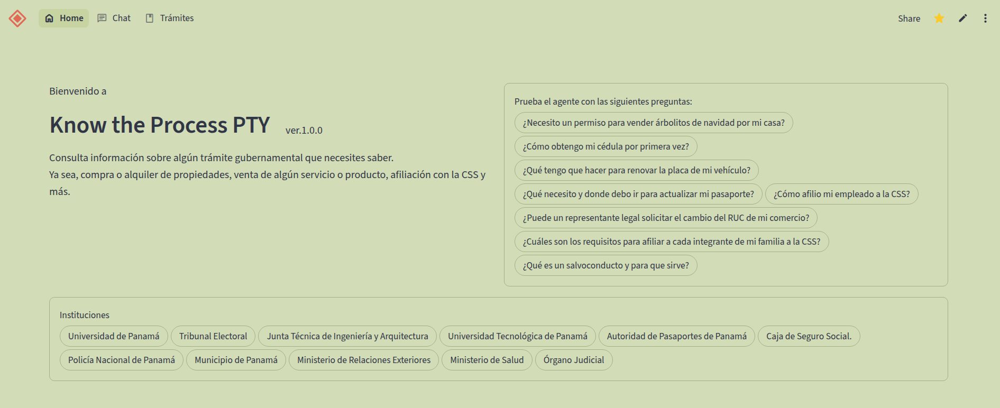

# Know the Process PTY 

- **Enlace a la app**: [Know the Process PTY](https://knowtheprocess.streamlit.app/)
- **Autora**: Kathia Qui


## El problema

Los ciudadanos de Panamá tienen a la mano, plataformas digitales donde encontrar información sobre todos los trámites gubernamentales. No obstante, a la hora de averiguar el proceso de una, esta no posee una estructura o un búscador intuitivo que lo facilite. En ocasiones, hasta necesitas conocer la definición de los términos utilizados para saber cuál es el trámite que necesitas realizar.
Este agente resolverá el proceso de búsqueda de información sobre el trámite en página digital del gobierno. Esta deberá inferir cuál trámite corresponde a las necesidades del usuario. 
Queda por fuera la validación de dicha información por parte de terceros; ya sea que, esta se encuentre incompleta o des-actualizado.


## Qué hace
Provee información e indicaciones sobre un trámite acorde a la pregunta del usuario. Además, la aplicación mantiene lista de trámites, los cuales, puedes filtrar por institución y nombre del traḿite.


## La pieza de IA
La librería de Langchain para: embeddings de la data recolectada y búsqueda de la misma con `gemini-embedding-2` y `gemini-3.5-flash-lite` para la redacción de las consultas bajo un conjunto de reglas pre-definidas.
La base de datos está conformado por un chroma ubicado en [chroma_db](./chroma_db/), originado de un total de 333 documentos previamente vectorizado, esto con el propósito de evitar la vectorización de la misma data por cada reboot de la aplicación. 
La aplicación se encuentra levantada en Streamlit Community Cloud con sus respectivas variables de entorno en el `secrets` de Streamlit.
Si se acaba la cuota o falla la red, la app responde con un mensaje claro en lugar de romperse.

## Cómo la he construido
- **Herramientas**: gemini-3.5-flash-lite y gemini-embedding-2
- **Fichero de contexto del agente**: AGENTS.md & especificacion.md
- Los **prompts** reales se pueden encontrar en la página principal de la aplicación. También, en la constante `PROMPTS` en el [constants.py](./static/constants.py).

## Prueba y mejora

| Quién la probó | Qué probó | Qué pasó | Qué cambié |
|---|---|---|---|
| yo | Consulté cómo obtener el DNI por primera vez | El agente no supo responder | Reconstruí la base de datos con data más relevante |


## Ejecutar en local (opcional)
### Instala las dependencias
```bash
pip install -e .
```

Inserta la clave en `.streamlit/secrets.toml`.
```bash
API_KEY="gemini_api_key"
AGENT_MODEL="gemini-3.5-flash-lite"
EMBEDDING_MODEL="gemini-embedding-2"
COLLECTION="tramites_db"
```

### Ejecuta la aplicación
```bash
streamlit run app.py
```

## Capturas



[La app funcionando, la app ante un caso límite, un momento de vuestro trabajo con la IA y la prueba. Sin ninguna clave a la vista.]

--- 